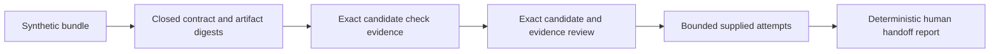

# Architecture

`contracts.mjs` validates the full bundle before evaluation, including unused later
attempts. It rejects unknown fields, duplicate check/reviewer identities, repeated
candidate heads, a changed base and inconsistent content/log digests. Candidate
paths are validated identifiers inside the JSON; they are never resolved or executed.

`canonical.mjs` sorts object keys and uses JSON serialization. It is a documented
local canonical form, not a claim of RFC 8785 compliance. File/check collections
are sorted by path/name for their own content/evidence digests; the overall bundle
digest also preserves the order of its arrays. SHA-256 binds data, not an identity.

`pipeline.mjs` evaluates up to the policy ceiling, stopping on the first accepted
attempt. Evidence must match both the candidate SHA label and content digest.
Reviews additionally bind the current complete evidence digest. Required checks
are `lint` and `tests`; required reviewer labels are `quality` and `security`.
These are example policy choices, not the private engine's review rules.

A missing/stale/failed input prevents acceptance. A rejected final allowed attempt
becomes `budget-exhausted`; rejected input with spare budget becomes
`awaiting-revision`. No attempts are generated, retried, fixed or scheduled by the
program. `recovered` consumes two predefined attempts, not a live builder run.

`cli.mjs` exports the validated input bundle plus summaries and schemas. Writes use
exclusive creation and permit identical reruns only. A multi-file export is not an
atomic transaction: a failure can leave a partial directory, which must be inspected
before reuse. Input files are local regular files capped at 256 KiB. Error messages
use controlled codes, never submitted source, logs or raw filesystem/provider errors.

The human handoff boundary is explicit: all execution, model-call, push, merge and
deploy authority fields are false. There is no publisher, worker runtime, model
adapter, Git client, token flow, remote repository integration or production contract.

## Trace a revision through the boundary

For an accepted candidate A, each check binds A's SHA label and content digest; each review also binds the digest of the complete check collection. Candidate B cannot inherit that approval: a different SHA label produces `stale_review`, even if its source content matches A. If check content changes, its log digest must validate and the resulting evidence digest must match each review. Consistent but stale records are rejected by evaluation; internally inconsistent artifact digests are rejected by contract validation.

In `recovered`, the first predefined attempt is rejected for `changes_requested`. The second supplies a fresh candidate and matching check/review records and is accepted within the two-attempt ceiling. This is evaluation of supplied history, not execution of an edit/retest/review loop.

The design responsibilities described in the [README author contribution](../README.md#author-contribution) belong to this standalone evaluator. [Agent Reliability Lab](https://github.com/MargusHemlex/agent-reliability-lab) separately exercises real worker lifecycle and receiver-effect recovery. No worker, receipt database or production integration is implied by this pipeline's diagram.
